# Visual-Inertial Odometry

Two-phase study of visual-inertial odometry (VIO): estimating a moving
platform's 6-DoF pose from a stereo camera + IMU. **Phase 1** is a
from-scratch classical filter — Stereo MSCKF — evaluated on the EuRoC MAV
Machine Hall dataset. **Phase 2** is a deep-learning system — three
neural-network branches (vision-only, IMU-only, fused) — trained on
synthetic Blender drone trajectories under a controlled six-experiment
diagnostic protocol. Both halves are evaluated with the same metric —
Absolute Trajectory Error (ATE) under Umeyama SE(3) alignment — so results
are directly comparable.

- [Phase 1: Classical VIO](#phase-1-classical-vio) — S-MSCKF, EuRoC Machine Hall.
- [Phase 2: Deep VIO](#phase-2-deep-vio) — three-branch learned VIO, synthetic Blender trajectories.

---

# Phase 1: Classical VIO

Python implementation of the Stereo Multi-State Constraint Kalman Filter
(S-MSCKF) for WPI RBE/CS549 P4. Seven functions in `Code/Phase 1/msckf.py` were
implemented from scratch following the two reference papers and the authors'
C++ implementation; everything else (feature tracking, triangulation,
viewer) ships with the starter code. A per-sequence analysis of MH_01_easy
and the outlier sequences, together with a detailed walk-through of each
implemented function and the comparison with the paper, lives at
[`Results/Phase1/analysis.md`](Results/Phase1/analysis.md).

## References

| short-name | full citation | file |
|---|---|---|
| **S-MSCKF** | Sun et al., *Robust Stereo Visual Inertial Odometry for Fast Autonomous Flight*, RA-L 2018 | `1712.00036v3.pdf` |
| **MSCKF'07** | Mourikis & Roumeliotis, *A Multi-State Constraint Kalman Filter for Vision-aided Inertial Navigation*, ICRA 2007 | `ICRA07-MSCKF.pdf` |
| **C++ ref** | `KumarRobotics/msckf_vio` | `msckf_vio-master/src/msckf_vio.cpp` |

Conventions: JPL quaternion `[x, y, z, w]`, `imu_state.orientation` rotates
world→IMU, gravity in world frame is `[0, 0, −g]`.

## Code layout

```
Code/
└── Phase 1/            active code — run everything from this directory
    ├── msckf.py
    ├── utils.py, config.py, dataset.py, image.py, feature.py
    ├── vio.py, run_eval.py, evaluate.py, run_all.py
    ├── plot_errors.py
    ├── viewer_mpl.py
    ├── README.md       (original starter README, kept for reference)
    ├── imgs/           (sample trajectory image shipped with starter)
    ├── test/           (unit tests for utils.py and the triangulator)
    └── Misc/           archived / redundant — not used at runtime
        ├── msckf_an.py   (partial reference with 2 bugs; never imported)
        ├── viewer.py     (pangolin viewer — superseded by viewer_mpl.py)
        └── make_video.py (offline MP4 renderer — superseded by screen recording)
```

## How to run

### 1. Run the filter on one sequence

```
cd "Code/Phase 1"
python3 vio.py --path ../../Data/machine_hall/MH_01_easy/MH_01_easy          # headless
python3 vio.py --view --path ../../Data/machine_hall/MH_01_easy/MH_01_easy   # viewer (see "Live visualisation" below for the full command with GT overlay)
```

### 2. Dump an estimated trajectory CSV (for evaluation / plotting)

```
cd "Code/Phase 1"
python3 run_eval.py \
    --path /path/to/MH_01_easy \
    --out  ../../Results/Phase1/MH_01_easy_est.csv \
    --offset 40 --ratio 1.0
```

`--offset` seconds are skipped so the first IMU buffer is static (needed by
`initialize_gravity_and_bias`). `--ratio` < 1 slows playback.

### 3. Compute ATE RMSE + save a trajectory plot

```
python3 evaluate.py \
    --est ../../Results/Phase1/MH_01_easy_est.csv \
    --gt  ../Data/machine_hall/MH_01_easy/MH_01_easy/mav0/state_groundtruth_estimate0/data.csv \
    --plot ../../Results/Phase1/MH_01_easy_traj.png \
    --title MH_01_easy
```

### 4. Run everything end-to-end

```
cd "Code/Phase 1" && python3 run_all.py
```

Loops over all 5 Machine Hall sequences, writes `Results/Phase1/*_est.csv`,
`Results/Phase1/*_traj.png`, and `Results/Phase1/summary.json`.

### 5. Generate the 6 trajectory-error plots (Figs 1–6)

```
python3 plot_errors.py \
    --est ../../Results/Phase1/MH_01_easy_est.csv \
    --gt  ../Data/machine_hall/MH_01_easy/MH_01_easy/mav0/state_groundtruth_estimate0/data.csv \
    --out-dir ../../Results/Phase1/MH_01_easy_plots \
    --title MH_01_easy
```

Produces `fig1_trans_error.png`, `fig2_rot_error.png`, `fig3_rel_trans_error.png`,
`fig4_rel_yaw_error.png`, `fig5_traj_side.png`, `fig6_traj_top.png`. See
[Error plots](#error-plots) below.

## Results

### ATE (SE(3)-aligned) against Vicon ground truth

Absolute Trajectory Error after Umeyama SE(3) alignment, no scale correction.
Timestamps are nearest-neighbour-associated between estimate and GT with a
20 ms tolerance. Numbers in metres.

| Sequence          |  RMSE |  mean | median |   max | poses | offset (s) |
|-------------------|------:|------:|-------:|------:|------:|-----------:|
| MH_01_easy        | 0.083 | 0.078 |  0.076 | 0.180 |  2841 |         40 |
| MH_02_easy        | 0.377 | 0.317 |  0.274 | 1.117 |  2798 |         10 |
| MH_03_medium      | 0.173 | 0.159 |  0.147 | 0.337 |  2459 |         10 |
| MH_04_difficult   | 0.898 | 0.711 |  0.514 | 2.544 |  1976 |          0 |
| MH_05_difficult   | 0.916 | 0.739 |  0.530 | 2.530 |  2222 |          0 |

Results are in the expected range for a Python S-MSCKF port: sub-10 cm on
MH_01 (long static taxi, slow motion), ~15–40 cm on the mid sequences, and
~0.9 m on the difficult flights where takeoff starts without a long static
window and aggressive motion stresses the linearisation assumptions. See
[`Results/Phase1/analysis.md`](Results/Phase1/analysis.md) for a per-sequence
breakdown of where the errors come from.

### Comparison with the S-MSCKF paper

| Sequence           | Ours RMSE (m) | Paper RMSE (m, ~Fig. 2a) | Δ vs paper |
|--------------------|--------------:|-------------------------:|-----------:|
| MH_01_easy         |     **0.083** |                    ~0.22 |      −0.14 |
| MH_02_easy         |         0.377 |       *not reported*     |          — |
| MH_03_medium       |     **0.173** |       *not reported*     |          — |
| MH_04_difficult    |         0.898 |                    ~0.48 |      +0.42 |
| MH_05_difficult    |         0.916 |                    ~0.46 |      +0.46 |

Discussion of the gap (reading the paper's other bars, likely drivers,
per-dataset offset tuning, MH_04 image-count mismatch) lives in
[`Results/Phase1/analysis.md`](Results/Phase1/analysis.md) §6.

### Trajectory plots

Each plot shows the SE(3)-aligned estimated trajectory (red) against the
Vicon ground truth (black). Left panel is the top-down X–Y view; right
panel is altitude vs sample index.

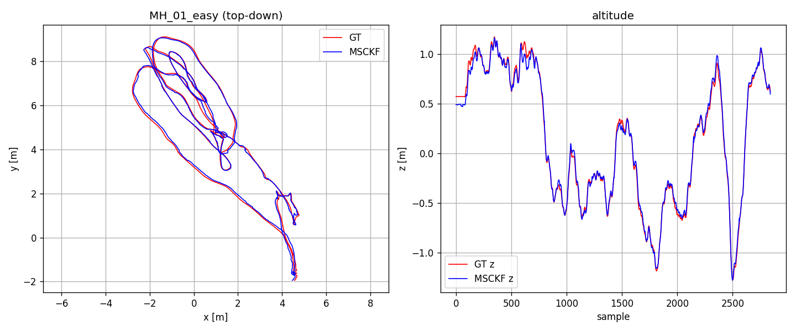

Trajectory PNGs for MH_02/03/04/05 live under `Results/Phase1/*_traj.png`.

### Error plots

Following `rpg_trajectory_evaluation` (Zhang & Scaramuzza, IROS'18). Six
figures are emitted per sequence by `Code/Phase 1/plot_errors.py` under
`Results/Phase1/<seq>_plots/`:

- **Fig 1 — Translation error.** `(est_aligned − gt)` decomposed into
  x/y/z in millimetres, plotted vs cumulative distance along the GT
  trajectory. Shows where drift accumulates.
- **Fig 2 — Rotation error.** `R_err = R_gt.T · R_est_aligned`, decomposed
  into yaw/pitch/roll (ZYX intrinsic, degrees) vs distance.
- **Fig 3 — Relative translation error.** Boxplot at 5 sub-trajectory
  lengths (10/20/30/40/50% of total length). For each start index `i`, we
  pick `j` as the first index with `d(i, j) ≥ target`, compute the
  relative-pose error `T_err = (T_gt_i⁻¹ T_gt_j)⁻¹ (T_est_i⁻¹ T_est_j)`,
  and box-plot `‖T_err.t‖`.
- **Fig 4 — Relative yaw error.** Same pair-sampling, plotting
  `|yaw(R_err)|` in degrees.
- **Fig 5 — Trajectory (side view).** x vs z. Estimate blue, GT pink.
- **Fig 6 — Trajectory (top view).** x vs y. Estimate blue, GT pink.

MH_01_easy:


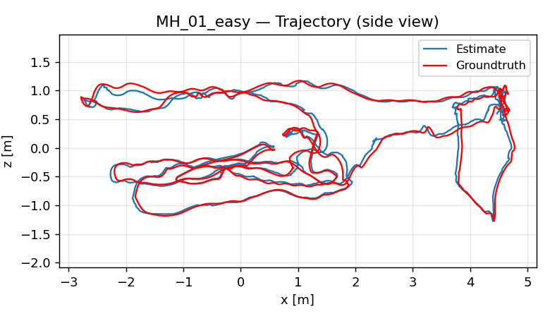
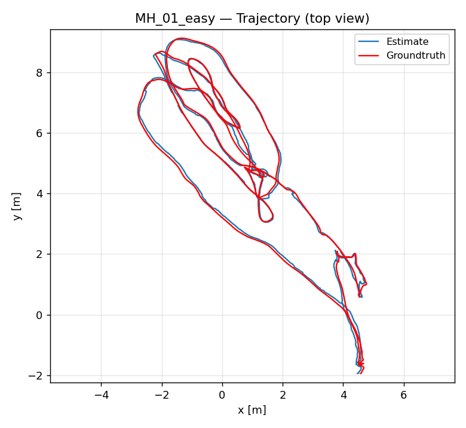

Plots for the other sequences live under `Results/Phase1/MH_02_easy_plots/`,
`Results/Phase1/MH_03_medium_plots/`, `Results/Phase1/MH_04_difficult_plots/`,
`Results/Phase1/MH_05_difficult_plots/`.

### Live visualisation

A single-window live viewer shows the estimate growing against the Vicon
ground truth in real time. GT is brought into the filter frame via the
same Umeyama SE(3) alignment used for ATE, so the two trajectories overlay
directly. Rendered with OpenCV only — no pangolin / matplotlib dependency.

Panels:
- **Left**: top-down X–Y trajectory — ground truth in **pink**, MSCKF estimate
  in **black**, current pose a **blue** square. 1 m scale bar bottom-left.
- **Right**: live `cam0` frame.
- **Bottom**: pose count and elapsed seconds.

```
cd "Code/Phase 1" && python3 vio.py --view --ratio 1.0 --offset 40 \
    --path ../../Data/machine_hall/MH_01_easy/MH_01_easy \
    --est  ../../Results/Phase1/MH_01_easy_est.csv \
    --gt   ../../Data/machine_hall/MH_01_easy/MH_01_easy/mav0/state_groundtruth_estimate0/data.csv
```

`--est` is any prior baseline run dumped by `run_eval.py`; it only supplies
the points used to fit the GT→filter Umeyama transform. Without `--gt`/`--est`
the plot bounds collapse and the trajectory won't render — always pass both
when using `--view`. `--ratio 1.0` is real-time; lower values slow playback.
Press `q` or `Esc` to quit.

To capture a run, screen-record the viewer window (e.g. `ffmpeg -f x11grab
-framerate 30 -video_size 1920x1080 -i :0.0 -c:v libx264 -preset ultrafast
-pix_fmt yuv420p Output.mp4`, or GNOME's `Ctrl+Alt+Shift+R`).

## Repo layout

- `Code/Phase 1/` — active Python implementation.
- `Code/Phase 1/Misc/` — archived / unused files (`msckf_an.py`, `viewer.py`).
- `msckf_vio-master/` — authors' C++, used as the line-by-line reference.
- `1712.00036v3.pdf`, `ICRA07-MSCKF.pdf` — the two papers.
- `Data/machine_hall/` — EuRoC ASL-format sequences (extracted).
- `Results/Phase1/` — generated est trajectories, trajectory PNGs, error plots
  (one `<seq>_plots/` directory per sequence), `analysis.md`, and `summary.json`.

Unit tests for the quaternion / rotation utilities:

```
cd "Code/Phase 1/test" && python3 utils_test.py
```

---

# Phase 2: Deep VIO

A three-branch deep-learning VIO system trained on synthetic Blender drone
trajectories: a vision-only network, an IMU-only network, and a fused
network that learns a bounded residual correction on top of the vision
estimate. Built and evaluated across **six controlled diagnostic
experiments**, each changing one confound at a time, to characterise when
learned sensor fusion actually helps versus when a single branch wins on
its own.

## The three networks

| Branch | Architecture | Inputs | Output |
|---|---|---|---|
| **V** (vision) | VGG-8 CNN, 512-d feature, two MLP heads | Two stacked RGB frames `(B, 6, 480, 640)` | `R ∈ SO(3)`, `t ∈ ℝ³` |
| **I** (inertial) | Bidirectional 2-layer LSTM, all-layers concat → 512-d | 10-sample IMU window `(B, 10, 6)` — accel + gyro, body frame, gravity preserved | `R ∈ SO(3)`, `t ∈ ℝ³` |
| **VI** (fused) | Residual refiner over `(V_feat, I_feat)`, bounded `tanh` deltas (\|δR\|≤0.1 rad, \|δt\|≤0.2 m) | Image pair + IMU window | `R = δR·R_v`, `t = t_v + δt` |

All branches output a **6-D continuous rotation representation** (Zhou et
al. 2019) — Gram-Schmidt on the first two columns of `R` — to avoid
quaternion sign ambiguity and axis-angle singularities at identity.
Rotation loss is geodesic SO(3); translation loss is L1, with a sigmoid
hover-weight so the network can't "win" by predicting zero on near-static
frames.

## Six-experiment diagnostic story

Each row changes **one** confound at a time relative to the row above.
Numbers are mean ATE in metres (lower is better):

| # | Step | Setup change | V | I | VI | Lesson |
|---|---|---|---:|---:|---:|---|
| 1 | F | Mixed texture per trajectory (baseline) | 11.81 | 3.46 | 6.94 | broken — texture confound |
| 2 | G | **Fixed** texture (`tex_03`) | 5.29 | 1.78 | 2.35 | texture isolated → V −55% |
| 3 | H | **t-direct** prediction (no t/d decomposition) | 3.86 | 1.78 | 3.36 | parameterisation matters |
| 4 | J | **Simple shapes**, 30s, single speed | 0.089 | 1.51 | 0.131 | V drops **43×** — within-family is solvable |
| 5 | K | + **varied (slow) speeds** | 0.184 | 1.24 | **0.173** | **VI beats V for the first time** |
| 6 | S | + corrected IMU pipeline + bidirectional LSTM + higher speeds | 1.16 | 1.36 | 1.63 | I-fix verified per-trajectory; mean dragged up by out-of-distribution slow cases |

### The Step-S IMU pipeline correction

The pre-Step-S synthetic IMU pipeline did **three stacked finite
differences** (position → velocity → acceleration → roll/pitch → angular
velocity), producing **2.34 rad/s gyro spikes** at trajectory boundaries
on cosine-start families. It was rebuilt analytically: analytic
velocity/acceleration from the trajectory samplers, coordinated-turn
attitude (body-x along velocity, body-z along thrust) so yaw tracks
orbital motion physically, specific force computed as `Rᵀ(a_world −
g_world)` (gravity not pre-subtracted, following AirIO), and body angular
velocity from `Rᵀ Ṙ` — a single finite-diff stage on a continuous rotation
matrix, instead of three stacked stages. Result: gyro boundary spikes
dropped from **2.35 → 0.42 rad/s**, and Step S is the first run where all
three branches learn simultaneously.

## Headline per-trajectory result (Step S, ellipse held out of training)

| traj | speed | V | I | VI | notes |
|---|---|---:|---:|---:|---|
| 410 | 0.3 m/s (OOD-slow) | 3.00 | 2.20 | 3.31 | all three fail — slower than every training trajectory |
| 411 | 0.5 m/s | 0.76 | 1.60 | 2.29 | in-range; refiner over-corrects |
| 412 | **0.8 m/s** | 0.27 | **0.43** | **0.16** | **VI < V, best per-trajectory result in the project** |
| 413 | 1.2 m/s | 0.62 | 1.21 | 0.75 | train-ceiling speed |

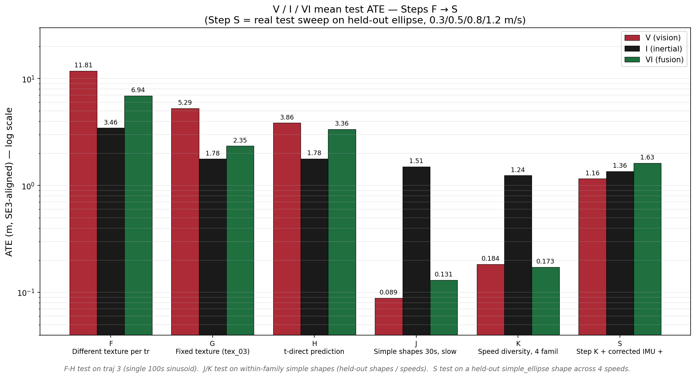
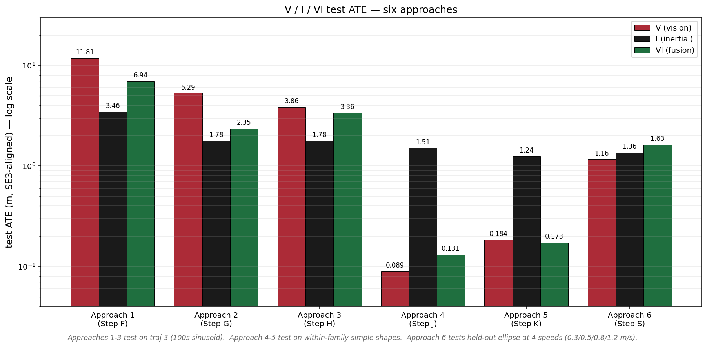

Trajectory 412 (ellipse @ 0.8 m/s) is the project's punchline — the one
case where the fused network beats both single-modality branches:

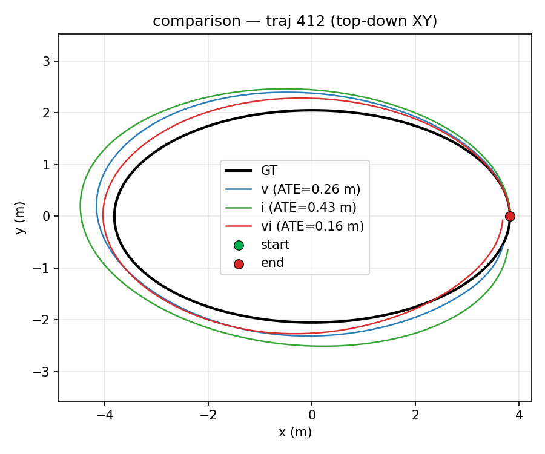
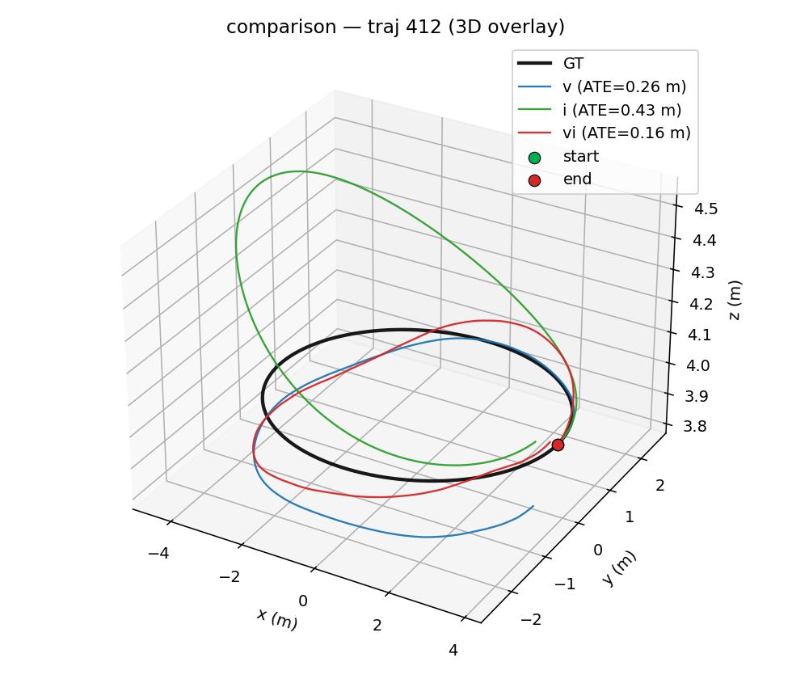

VI training/validation curves — the two-stage training schedule
(refiner-only for 10 epochs, then unfrozen) is visible as a kink at epoch 10:

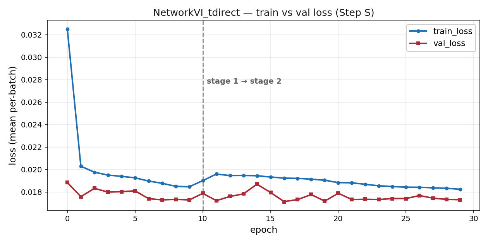
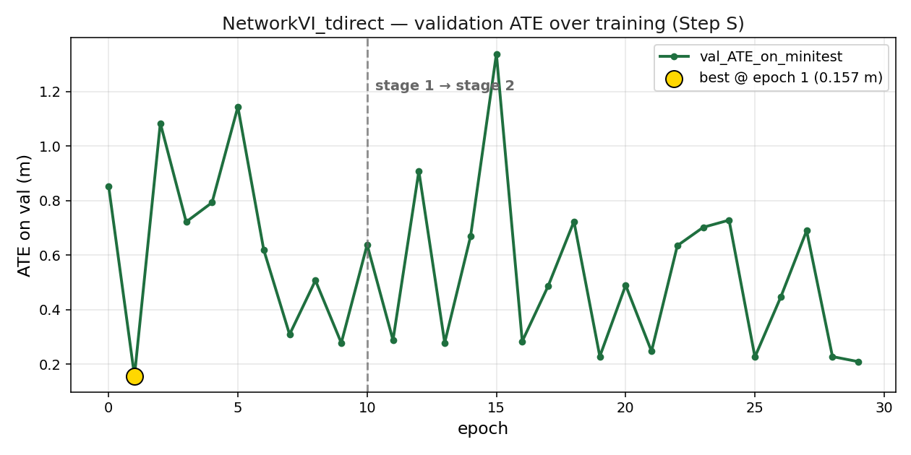

Aggregate error characterisation across the full test set:

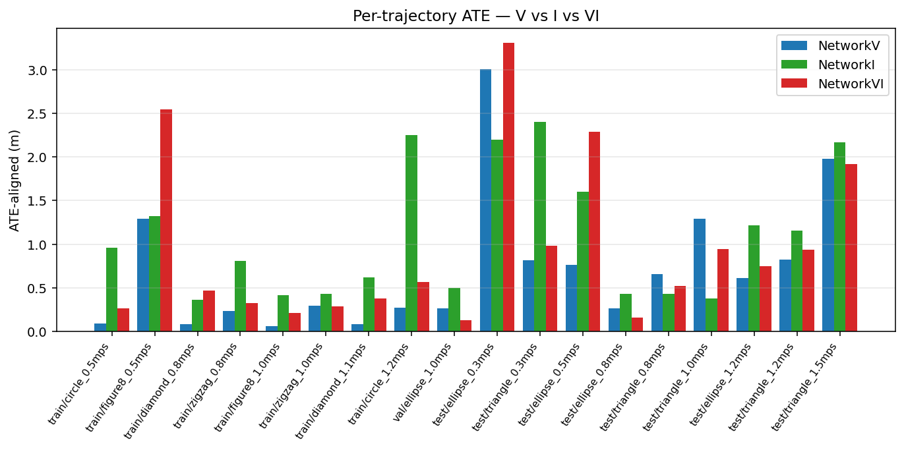
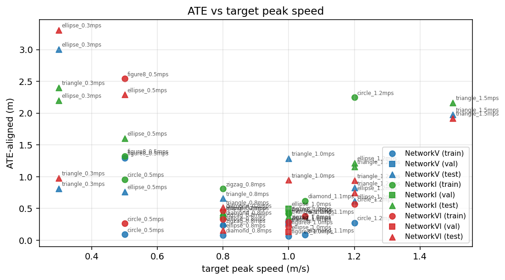

For contrast, an early Step-H VI trajectory (pre simple-shapes data fix),
drifting badly on a 100s sinusoid:

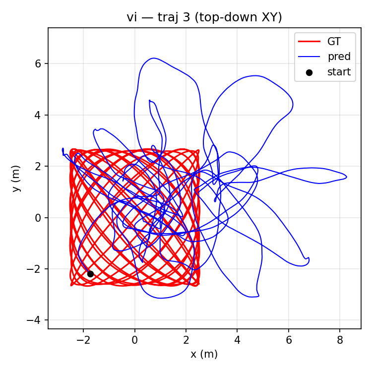

### Drone flight videos (Blender)

Blender (Cycles, GPU) renders of a quadrotor flying the trajectories from the
two best Phase 2 steps, over one of the carpet textures used for training data.

**How to read the render:**

- **Pink trail + white drone = ground truth.** The true 6-DoF path the drone
  actually flew (the simulator's pose, `gt.tum`). The white drone is placed at
  the true pose at each frame, and the pink ribbon is the path it has covered so far.
- **Blue trail + blue ghost drone = network prediction.** The path the trained
  network estimated from the rendered camera images (V) or from images + IMU (VI),
  from `pred.tum`. The blue ghost drone is placed at the *predicted* pose at the
  same timestamp.
- **The gap between blue and pink is the error.** Where the two trails overlap,
  the estimate is accurate; where they separate, the network has drifted. The
  reported ATE is the RMS of that gap after SE(3) alignment. The renders show the
  raw, unaligned prediction, so a constant offset between the trails is not
  counted as error in the ATE number.
- Each video cuts between a wide shot, a chase camera and a top-down view
  (30 s of flight, shown at 2x speed). Floor = one of the carpet textures used
  to generate the training data.

| Step | Trajectory | Network | ATE (SE(3)-aligned) | Video |
|---|---|---|---:|---|
| **K** | ellipse, 0.3 m/s (test) | V | 0.082 m | [`drone_step_k.mp4`](Results/Phase2/videos/drone_step_k.mp4) |
| **S** | ellipse, 0.8 m/s (test) | VI | 0.161 m | [`drone_step_s.mp4`](Results/Phase2/videos/drone_step_s.mp4) |

[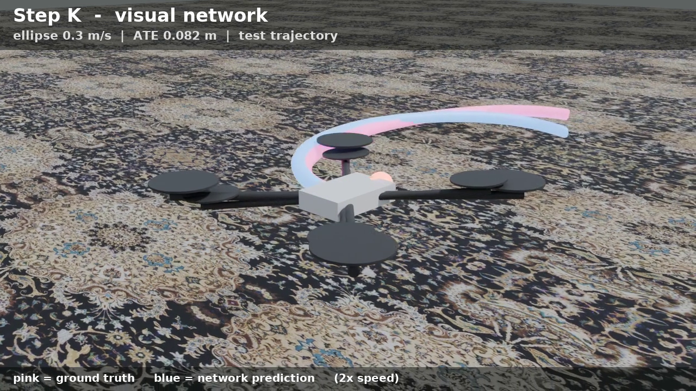](Results/Phase2/videos/drone_step_k.mp4)
[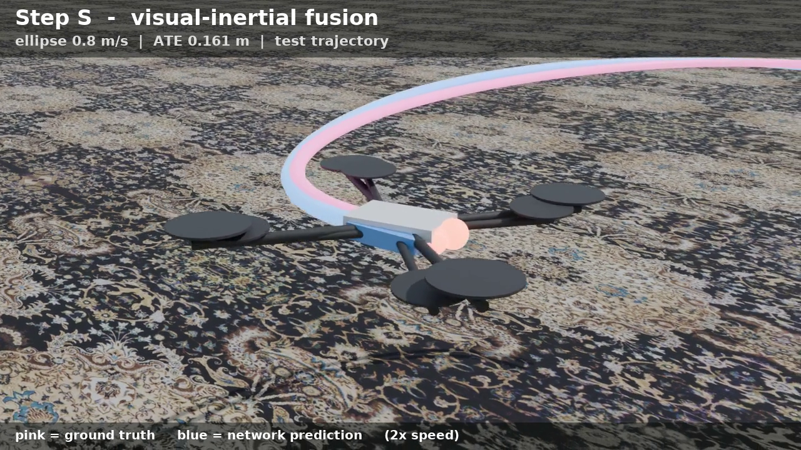](Results/Phase2/videos/drone_step_s.mp4)

Rendered from each run's `gt.tum` / `pred.tum` in
`Code/Phase 2/full_results/step_{k,s}/` (script and Slurm job live in
`~/vio/tools/blender_video/` on turing; script copy at
[`render_drone_video.py`](Results/Phase2/videos/render_drone_video.py)). Step K is a
visual-only network on slow trajectories, so its absolute error is not directly
comparable to Step S (faster trajectories, full V/I/VI comparison).

## Evaluation

- **ATE under SE(3) alignment** (not Sim(3)), so scale-collapse failures
  stay visible. A documented cross-family lesson: an apparent 3× ATE drop
  under a distribution shift turned out to be an SE(3)-alignment artifact
  — the Sim(3) numbers were identical. Always sanity-check with Sim(3)
  when ATE drops dramatically across a distribution shift.
- **2-second sliding-window RPE** (`seg2s_median`, `seg2s_p95`) as the
  per-frame quality signal that alignment can't hide.
- Dead-reckoning to absolute pose, then per-trajectory top-down, 3-D,
  RPY-error, and per-axis-error overlay plots vs ground truth.

## Top limitations

1. **VGG-8 receptive-field cap** — fails when inter-frame pixel motion
   exceeds ~3–5 px (Step S at 1.2 m/s ≈ 8–10 px). A RAFT / cost-volume
   encoder with explicit displacement search would fix this.
2. **10 ms IMU window** puts the I branch at the gravity-integration noise
   floor (per-window translation signal ~5 mm, gravity noise ~0.5 mm).
   Modern learned-IMU papers (TLIO, RoNIN, AirIO) use 200–1000 ms windows.
3. **Bounded residual refiner has no fail-safe** — when V is wrong by more
   than ±0.1 rad / ±0.2 m, VI is also wrong by more than that. A
   confidence-gated fusion that can fall back to I would address this.
4. **Single-frame-pair prediction, no temporal recurrence** — errors
   integrate linearly with trajectory length.
5. **Synthetic-only** (one texture, one altitude, ideal IMU) — zero
   variance on three deployment-relevant axes.

## Code layout

```
Code/
└── Phase2_main/         final submission code — a strict subset of the full
                          Phase 2 dev tree, only what's needed to train/evaluate
    ├── README.md         full file map + how-to-run
    ├── requirements.txt
    ├── scripts/          train_v.py, train_i.py, train_vi.py, evaluate.py,
    │                     full_results_eval.py (the exhaustive deliverable runner)
    ├── models/           network_v_tdirect.py, network_i.py, network_vi_tdirect.py,
    │                     refiner.py, backbones.py, losses.py, losses_tdirect.py
    ├── utils/            dataloader.py, training.py, eval.py, geometry.py,
    │                     stratified_sampler.py
    └── configs/          step_k.yaml (speed-diverse baseline), step_s.yaml (final pipeline)
```

Data generation (Blender trajectory rendering, IMU simulation) and SLURM
job scripts are not part of this repo — see
[`Code/Phase2_main/README.md`](Code/Phase2_main/README.md) for the full
file map and exact training/evaluation commands.

## Repo layout

- `Code/Phase2_main/` — final training/evaluation code (see above).
- `Results/Phase2/portfolio/` — the 9 selected result images used above.
- `Results/Phase2/plot_summary.json` — aggregate metrics.
- `Results/Phase2/presentation_step_s.pptx` — presentation deck for the final results.

## Stack

Python 3.6+ · NumPy · SciPy · OpenCV (cv2) · PyTorch · Matplotlib ·
Blender (EEVEE renders) · JPL quaternion convention · Umeyama SE(3)
alignment · 6-D continuous rotation representation (Zhou et al. 2019).

## References

| short-name | full citation |
|---|---|
| **Zhou et al. 2019** | *On the Continuity of Rotation Representations in Neural Networks*, CVPR 2019 |
| **AirIO** | Liu et al., gravity-preserving learned IMU integration |
| **RPG trajectory eval** | Zhang & Scaramuzza, *A Tutorial on Quantitative Trajectory Evaluation for Visual(-Inertial) Odometry*, IROS 2018 |
